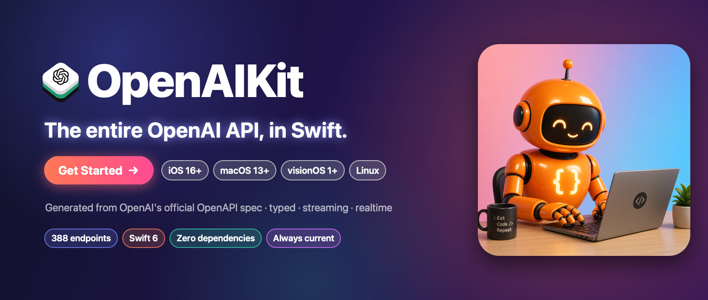
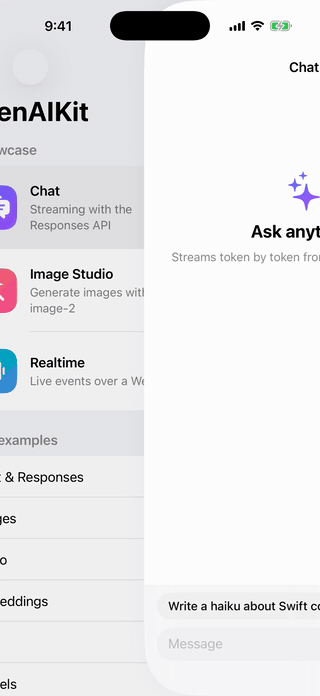
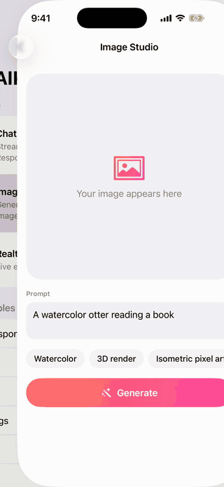
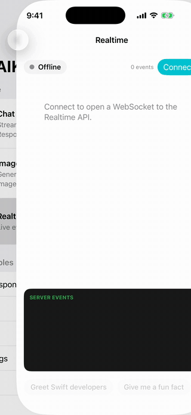

<p align="center">
  <a href="#quick-start"></a>
</p>

<p align="center">
  <a href="#quick-start"></a>
  <a href="#see-it-run"></a>
  <a href="MIGRATION.md"></a>
  <a href="https://github.com/OpenDive/OpenAIKit"></a>
</p>

<p align="center">
  <a href="https://github.com/OpenDive/OpenAIKit/actions/workflows/ci.yml"></a>
  <a href="https://swiftpackageindex.com/OpenDive/OpenAIKit"></a>
  <a href="https://swiftpackageindex.com/OpenDive/OpenAIKit"></a>
  
  
  <a href="LICENSE"></a>
</p>

---

## TL;DR

```swift
.package(url: "https://github.com/OpenDive/OpenAIKit.git", from: "4.2.0")
```

```swift
let client = OpenAI(apiKey: "sk-...")
let reply = try await client.responses.create(CreateResponse(model: "gpt-6.2-astra", input: "Hello!"))
print(reply.outputText)
```

- **All 388 OpenAI endpoints**, typed. Responses, Realtime, Images, Audio, Video, Agents, Admin: if it's in OpenAI's API reference, it's here.
- **Never stale.** Generated from OpenAI's [official OpenAPI spec](https://github.com/openai/openai-openapi). New models and fields arrive with one command.
- **Streams and talks in real time.** Typed `AsyncThrowingStream` events and Realtime WebSockets.
- **Ready for production.** Retries with backoff, cancellation, webhook verification and typed errors.
- **Swift 6, zero dependencies.** iOS, macOS, tvOS, watchOS, visionOS and Linux.

## See it run

Real recordings of the [example app](#demo-app) talking to the live API.

<table>
  <tr>
    <th width="33%">💬 Streaming chat</th>
    <th width="33%">🎨 Image generation</th>
    <th width="33%">⚡️ Realtime over WebSocket</th>
  </tr>
  <tr>
    <td></td>
    <td></td>
    <td></td>
  </tr>
  <tr>
    <td><code>client.responses.createStream</code></td>
    <td><code>client.images.generateStream</code></td>
    <td><code>client.realtime.connect</code></td>
  </tr>
</table>

## Why OpenAIKit

| | |
| --- | --- |
| 🧭 **Complete** | All 388 operations and 2,294 types in OpenAI's API, grouped like the official SDKs: `client.responses`, `client.audio.transcriptions`, `client.admin.organization.projects`… |
| 🔄 **Always current** | The Swift code is generated from OpenAI's spec. `python3 Generator/generate.py bump` picks up new endpoints, and CI fails if the code falls out of date. |
| 🛡️ **Forward-compatible** | Enums are open, so `model: "gpt-7"` compiles today. Unknown events and output items decode as `.unknown(JSON)` instead of crashing your stream. |
| 🌊 **Streaming everywhere** | `…Stream` methods return typed events for Responses, Chat, Audio, Images, Assistants and Agents. |
| ⚡️ **Realtime** | `client.realtime.connect(model:)` opens a typed WebSocket: send `RealtimeClientEvent`s, iterate `RealtimeServerEvent`s. |
| 🏭 **Production details** | Retries with exponential backoff that honor `retry-after`, `Task` cancellation, timeouts, auto-pagination, multipart uploads, Standard Webhooks verification and typed `OpenAIAPIError`s with request IDs. |
| 🧪 **Tested** | 769 examples from OpenAI's spec decode and round-trip in CI, on macOS, iOS, tvOS, watchOS, visionOS and Linux with Swift 6.2 to 6.4. |
| 🪶 **Lightweight** | No dependencies. Split into products so an app links only the APIs it uses: about 7 MB for the core APIs. Swift 6 strict concurrency, every type `Sendable`. |

## Install

**Xcode:** File › Add Package Dependencies… › `https://github.com/OpenDive/OpenAIKit.git` › Up to Next Major from `4.2.0`.

**Package.swift:**

```swift
dependencies: [
    .package(url: "https://github.com/OpenDive/OpenAIKit.git", from: "4.2.0")
],
targets: [
    .target(name: "YourTarget", dependencies: ["OpenAIKit"])
]
```

Requires Swift 6.2 (Xcode 26) or later, and iOS 16, macOS 13, tvOS 16, watchOS 9, visionOS 1 or Linux.

### Keep your app small

The `OpenAIKit` product includes the whole API. To link only what you use, depend on `OpenAIKitCore` and add the other products as needed. The types and methods are the same; just `import` the modules you depend on.

| Product | Covers | Adds to a release build* |
| --- | --- | --- |
| `OpenAIKitCore` | Responses, Chat Completions, Conversations, Audio, Images, Videos, Embeddings, Files, Uploads, Batches, Vector stores, Containers, Skills, Evals, Fine-tuning, Moderations, Models, Webhooks | ~7 MB |
| `OpenAIKitRealtime` | Realtime and Live, including `client.realtime.connect(...)` | + Realtime types |
| `OpenAIKitBeta` | Agents, Vaults, Assistants, Threads, ChatKit, beta Responses | + Beta types |
| `OpenAIKitAdmin` | Administration API: organization, projects, users, keys, usage, costs, audit logs | + Admin types |
| `OpenAIKit` | All of the above | ~18 MB |

<sub>*A minimal app making one Responses call and one Chat Completions stream, release build, stripped, on arm64.</sub>

```swift
.target(name: "YourApp", dependencies: [
    .product(name: "OpenAIKitCore", package: "OpenAIKit"),
    .product(name: "OpenAIKitRealtime", package: "OpenAIKit"), // only if you use Realtime
])
```

## Quick start

```swift
import OpenAIKit

let client = OpenAI(Configuration(apiKey: ProcessInfo.processInfo.environment["OPENAI_API_KEY"]))

let response = try await client.responses.create(
    CreateResponse(model: "gpt-6.2-astra", input: "Write a haiku about Swift.")
)
print(response.outputText)
```

> [!WARNING]
> **Don't ship your API key inside an app.** Anyone can pull it out of the binary. In apps, call OpenAI through your own server, or mint short-lived [Realtime client secrets](https://developers.openai.com/api/docs/guides/realtime). Get a key on the [API keys page](https://platform.openai.com/api-keys).

<details>
<summary><b>Configuration options</b></summary>

```swift
let client = OpenAI(Configuration(
    apiKey: "sk-...",
    organizationId: "org_...",
    projectId: "proj_...",
    requestOptions: OpenAIRequestOptions(timeoutInterval: 120, maxRetries: 3)
))
// On a server or in a command-line tool, read the standard environment variables.
let fromEnvironment = OpenAI(.fromEnvironment())
```

`Configuration.fromEnvironment()` reads `OPENAI_API_KEY`, `OPENAI_ADMIN_KEY`, `OPENAI_ORG_ID`, `OPENAI_PROJECT_ID`, `OPENAI_WEBHOOK_SECRET` and `OPENAI_BASE_URL`, the same variables the official SDKs use. Every method also takes `options:` to override the timeout, retries, headers or query for one call.

</details>

<details>
<summary><b>Proxying through your own server</b></summary>

Keep the OpenAI key on your server and point the app at it. With a `baseURL` other than `api.openai.com`, the API key is optional: without one, OpenAIKit sends no `Authorization` header, and you can authenticate to your server with your own headers. For full control over every request, pass your own `OpenAIHTTPTransport`.

```swift
// Your server adds the OpenAI key, so the app never holds it.
// With a base URL other than api.openai.com, no API key is required.
let client = OpenAI(Configuration(
    baseURL: URL(string: "https://api.example.com/openai/v1")!,
    requestOptions: OpenAIRequestOptions(additionalHeaders: ["Authorization": "Bearer \(userSessionToken)"])
))
```

The server should forward requests to `https://api.openai.com/v1` unchanged, including streaming responses.

</details>

## Cookbook

### 💬 Responses

[Responses](https://developers.openai.com/api/docs/guides/text) is OpenAI's main API for text, tools and multi-turn conversations.

```swift
let response = try await client.responses.create(
    CreateResponse(model: "gpt-6.2-astra", input: "Write a haiku about Swift.")
)
print(response.outputText)
```

### 🌊 Streaming

```swift
let request = CreateResponse(model: "gpt-6.2-astra", input: "Tell me a short story.")
for try await event in client.responses.createStream(request) {
    if let delta = event.outputTextDelta {
        print(delta, terminator: "")
    }
}
```

### 🧵 Conversations

```swift
let first = try await client.responses.create(CreateResponse(
    model: "gpt-6.2-astra",
    input: .inputItemList([
        .developer("Answer in one sentence."),
        .user("What is the capital of France?"),
    ])
))
let followUp = try await client.responses.create(CreateResponse(
    model: "gpt-6.2-astra",
    input: "And its population?",
    previousResponseID: first.id
))
print(followUp.outputText)
```

### 🛠️ Function calling

```swift
let weather = FunctionTool(
    name: "get_weather",
    description: "Current weather for a city.",
    parameters: [
        "type": "object",
        "properties": ["city": ["type": "string"]],
        "required": ["city"],
        "additionalProperties": false,
    ],
    strict: true
)
let response = try await client.responses.create(CreateResponse(
    model: "gpt-6.2-astra",
    input: "What's the weather in Paris?",
    tools: [.function(weather)]
))
struct WeatherArguments: Decodable { let city: String }
for call in response.functionCalls {
    let arguments = try call.decodeArguments(as: WeatherArguments.self)
    let output = FunctionCallOutputItemParam(output: "18°C and sunny in \(arguments.city)", callID: call.callID)
    let final = try await client.responses.create(CreateResponse(
        model: "gpt-6.2-astra",
        input: .inputItemList([.item(.functionCallOutput(output))]),
        previousResponseID: response.id
    ))
    print(final.outputText)
}
```

Built-in tools such as web search, file search, code interpreter, image generation, computer use, shell and MCP are cases of the same `Tool` enum.

### 🧱 Structured outputs

```swift
struct Recipe: Decodable {
    let name: String
    let minutes: Int
}
let format = TextResponseFormatJsonSchema(
    name: "recipe",
    schema: [
        "type": "object",
        "properties": ["name": ["type": "string"], "minutes": ["type": "integer"]],
        "required": ["name", "minutes"],
        "additionalProperties": false,
    ],
    strict: true
)
let response = try await client.responses.create(CreateResponse(
    model: "gpt-6.2-astra",
    input: "A quick pasta recipe.",
    text: ResponseTextParam(format: .jsonSchema(format))
))
let recipe = try response.decodeOutput(as: Recipe.self)
print(recipe.name, recipe.minutes)
```

### 🎨 Images

```swift
let result = try await client.images.generate(CreateImageRequest(
    model: "gpt-image-2",
    prompt: "A watercolor otter reading a book"
))
if let png = result.data?.first?.imageData {
    try png.write(to: URL(fileURLWithPath: "otter.png"))
}
```

<table>
  <tr>
    <td width="33%"></td>
    <td width="33%"></td>
    <td width="33%"></td>
  </tr>
  <tr>
    <td><sub><i>"A watercolor otter reading a book"</i></sub></td>
    <td><sub><i>"A friendly glossy orange robot mascot with a glowing curly-brace symbol on its chest, sitting at a laptop writing code, 3D render…"</i></sub></td>
    <td><sub><i>"An isometric floating island city built from glowing circuit boards and tiny server towers, waterfalls of light…"</i></sub></td>
  </tr>
</table>

<sub>Generated with `gpt-image-2` through OpenAIKit. `client.images.generateStream(...)` streams the result, `client.images.edit(...)` edits an image, and `client.videos` generates video.</sub>

### ⚡️ Realtime

```swift
let connection = try client.realtime.connect(model: "gpt-realtime-2")
defer { connection.close() }
try await connection.send(json: ["type": "response.create"])
for try await event in connection.events {
    print(event)
}
```

`client.responses.connect()` opens the Responses API's WebSocket mode the same way. For apps, mint a short-lived key on your server with `client.realtime.clientSecrets.create(...)`.

<details>
<summary><b>🎙️ Audio: transcription and speech</b></summary>

```swift
let audioURL = URL(fileURLWithPath: "meeting.m4a")
let transcript = try await client.audio.transcriptions.create(CreateTranscriptionRequest(
    model: "gpt-4o-transcribe",
    file: try FileUpload(contentsOf: audioURL)
))
if case .json(let json) = transcript {
    print(json.text)
}

let speech: Data = try await client.audio.speech.create(CreateSpeechRequest(
    model: "gpt-4o-mini-tts",
    input: "Hello from OpenAIKit!",
    voice: "marin"
))
try speech.write(to: URL(fileURLWithPath: "hello.mp3"))
```

Use `client.audio.transcriptions.createText(...)` for `srt`, `vtt` or `text` output, and `SubtitleCue.parse(_:)` to read SRT and WebVTT.

</details>

<details>
<summary><b>🧠 Chat Completions</b></summary>

```swift
let completion = try await client.chat.completions.create(CreateChatCompletionRequest(
    model: "gpt-6.2-astra",
    messages: [
        .developer(text: "You are a helpful assistant."),
        .user(text: "Hello!"),
    ]
))
print(completion.firstContent ?? "")

let stream = client.chat.completions.createStream(CreateChatCompletionRequest(
    model: "gpt-6.2-astra",
    messages: [.user(text: "Count to five.")]
))
for try await chunk in stream {
    print(chunk.contentDelta ?? "", terminator: "")
}
```

</details>

<details>
<summary><b>🔢 Embeddings</b></summary>

```swift
let result = try await client.embeddings.create(CreateEmbeddingRequest(
    model: "text-embedding-3-small",
    input: "The quick brown fox"
))
print(result.data.first?.vector?.count ?? 0)
```

</details>

<details>
<summary><b>📁 Files and auto-pagination</b></summary>

Every cursor-paginated list has an `…All` variant that loads pages as you iterate.

```swift
let upload = FileUpload(data: Data("{\"prompt\":\"hi\"}\n".utf8), filename: "batch.jsonl")
let file = try await client.files.create(CreateFileRequest(file: upload, purpose: .batch))
print(file.id)

for try await file in client.files.listAll(limit: 100) {
    print(file.filename)
}
```

</details>

<details>
<summary><b>🪝 Webhooks</b></summary>

`unwrap` verifies the signature with your endpoint secret (`Configuration.webhookSecret`, or pass `secret:`) and decodes a typed `WebhookEvent`. Pass the raw request body exactly as received.

```swift
let event = try client.webhooks.unwrap(payload: body, headers: headers)
switch event {
case .responseCompleted(let completed):
    print("Response \(completed.data.id) finished")
default:
    break
}
```

</details>

<details>
<summary><b>🏢 Administration API</b></summary>

Projects, users, API keys, usage, costs and audit logs, with an [admin key](https://platform.openai.com/settings/organization/admin-keys):

```swift
let admin = OpenAI(Configuration(adminAPIKey: ProcessInfo.processInfo.environment["OPENAI_ADMIN_KEY"]))
for try await project in admin.admin.organization.projects.listAll() {
    print(project.name ?? project.id)
}
```

</details>

<details>
<summary><b>🚨 Errors, retries and cancellation</b></summary>

HTTP errors throw `OpenAIAPIError` with the status, OpenAI's message, type, code and the `x-request-id`. Everything else throws `OpenAIError`.

```swift
do {
    _ = try await client.models.retrieve(model: "does-not-exist")
} catch let error as OpenAIAPIError {
    print(error.statusCode, error.kind, error.message, error.requestID ?? "")
} catch {
    print(error.localizedDescription)
}
```

Connection errors, 408, 409, 429 and 5xx responses are retried twice by default, with exponential backoff and jitter, honoring `retry-after` and `x-should-retry`. Change it with `OpenAIRequestOptions(maxRetries:)`.

```swift
let task = Task {
    try await client.responses.create(CreateResponse(model: "gpt-6.2-astra", input: "Write a long essay."))
}
task.cancel() // The HTTP request is cancelled too; the call throws CancellationError.
```

</details>

<details>
<summary><b>🧪 Brand-new models</b></summary>

Model IDs are open enums: autocomplete lists the ones in the spec, and any string works.

```swift
_ = try await client.responses.create(CreateResponse(model: "gpt-7-preview", input: "Hi"))
```

</details>

## Every endpoint

| Area | Namespace |
| --- | --- |
| Responses, input items, input tokens, compaction | `client.responses` |
| Conversations | `client.conversations` |
| Chat Completions, stored completions | `client.chat.completions` |
| Realtime calls, client secrets, translations | `client.realtime` |
| Live sessions | `client.live` |
| Audio: speech, transcriptions, translations, voices | `client.audio` |
| Images, videos | `client.images`, `client.videos` |
| Embeddings, moderations | `client.embeddings`, `client.moderations` |
| Files, uploads, batches | `client.files`, `client.uploads`, `client.batches` |
| Vector stores | `client.vectorStores` |
| Containers, skills | `client.containers`, `client.skills` |
| Evals, fine-tuning, graders | `client.evals`, `client.fineTuning` |
| Webhook endpoints | `client.webhooks` |
| Safety, decisions, content provenance | `client.safety`, `client.decisions`, `client.contentProvenanceChecks` |
| Agents, vaults, ChatKit, Assistants (beta) | `client.beta` |
| Organization, projects, usage, costs, audit logs | `client.admin.organization` |
| Legacy completions | `client.completions` |

Each method's documentation shows OpenAI's description, its parameters and the HTTP route. Browse them in Xcode's Quick Help or on the [Swift Package Index](https://swiftpackageindex.com/OpenDive/OpenAIKit/documentation).

## Demo app

[`Examples/iOS_Example`](Examples/iOS_Example) is the app in the recordings above. Its **Showcase** section has the chat, image and Realtime screens, and **API examples** covers models, files, audio, embeddings, moderation and more. There are smaller macOS, tvOS and watchOS samples next to it.

1. Open `Examples/iOS_Example/iOS_Example.xcodeproj`.
2. Set `OPENAI_API_KEY` under Product › Scheme › Edit Scheme… › Run › Arguments › Environment Variables.
3. Run.

Or from the terminal, with the app installed on a booted simulator:

```bash
SIMCTL_CHILD_OPENAI_API_KEY="$OPENAI_API_KEY" xcrun simctl launch booted com.MarcoDotIO.iOS-Example
```

## How it stays current

[`Generator/generate.py`](Generator/README.md) turns a pinned commit of [openai/openai-openapi](https://github.com/openai/openai-openapi) into the Swift sources in `Sources/<Module>/Generated`. Method names follow [openai-python](https://github.com/openai/openai-python), so the official docs translate directly: `client.beta.threads.runs.submit_tool_outputs` there is `client.beta.threads.runs.submitToolOutputs` here.

```bash
python3 Generator/generate.py bump && swift test
```

## Migrating from 3.x

4.0 replaces the hand-written API with the generated one. [MIGRATION.md](MIGRATION.md) maps every 3.x call to its 4.0 equivalent. In short: flat methods became namespaces (`client.chat.completions.create`), request types are named after the spec (`CreateChatCompletionRequest`), streaming methods end in `Stream`, model enums accept any string, and the minimum platforms are now iOS 16 and macOS 13.

## Contributing

Issues and pull requests are welcome. Read [CONTRIBUTING.md](CONTRIBUTING.md) first. Generated code is never edited by hand: change the generator or the hand-written `Core/` and `Helpers/`, then run:

```bash
swift test && python3 Generator/generate.py check
```

Coding agents: [AGENTS.md](AGENTS.md) describes how to use and work on this repository.

## License

MIT. See [LICENSE](LICENSE). Use of the OpenAI API is subject to OpenAI's [usage policies](https://openai.com/policies/usage-policies). OpenAIKit is a community project and isn't affiliated with OpenAI.
